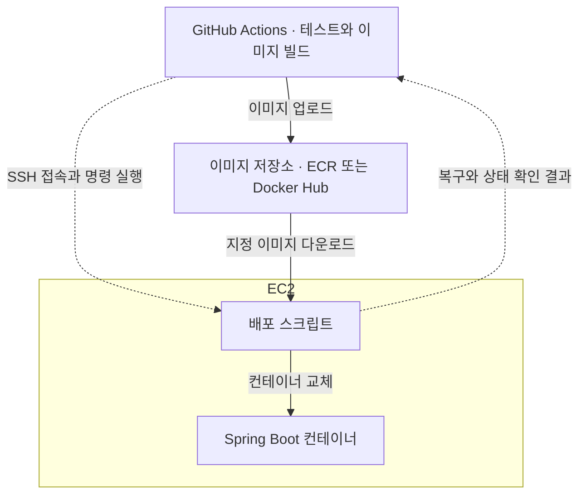
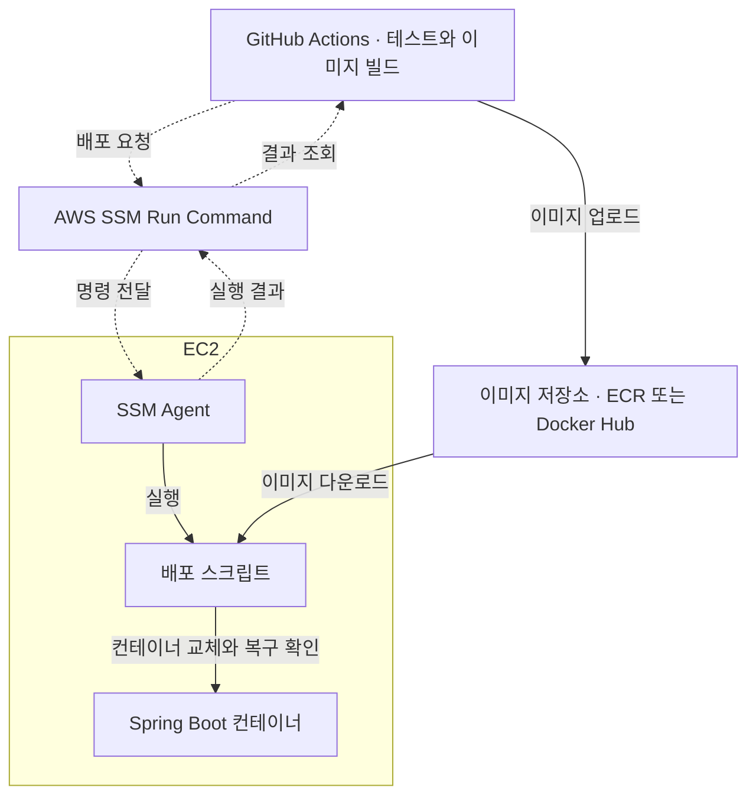
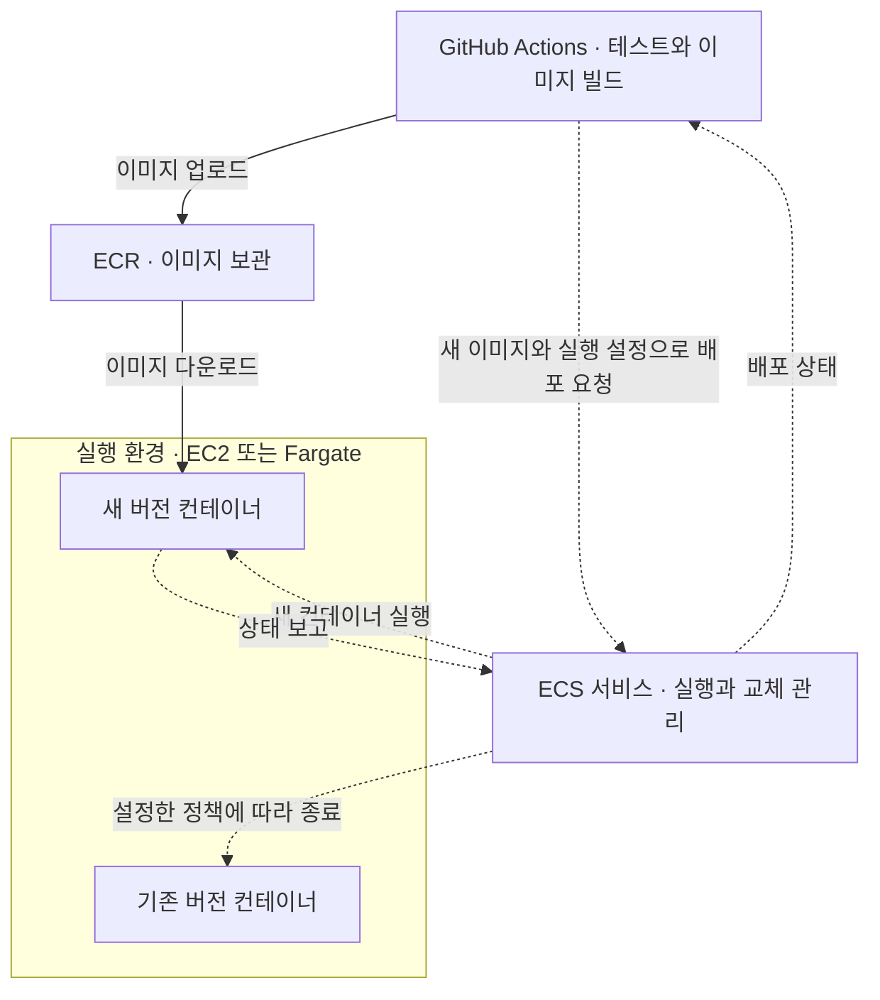

# 모의 주식 매매 시스템 — 새 프로젝트 구현 인계서

작성일 2026-11-06. 대상은 이 프로젝트를 구현할 Claude Code다.


## 0. 이 파일 사용 방법과 작업 대상

사용자가 새로 만든 Spring 프로젝트에서 구현한다. 현재 열려 있는 새 프로젝트가 작업 대상이다. `C:/dev/paper-trading`은 폴더 이름 예시이며 실제 프로젝트명·경로는 사용자가 정한 것을 따른다.

- `C:/dev/stock-prototype`은 초기 프로토타입을 비교하고 필요한 구현을 참고하기 위한 읽기 전용 자료다.
- 새로운 프로젝트에 독립된 Git 이력, 설정, 테스트, 실행 환경을 구성한다. 프로토타입의 `.git`, 비밀 설정, 빌드 산출물, 전체 `.claude` 지시서를 복사하지 않는다.
- 새 프로젝트의 Spring Boot·Java·Gradle 버전을 고정하지 않는다. 사용자가 생성한 프로젝트의 설정을 확인하고 그 환경에 호환되는 의존성을 사용한다. 변경이 필요하면 이유를 설명한다.
- 신 프로젝트와 프로토타입은 개발 DB 이름/사용자/Compose 리소스를 분리한다. 한쪽의 마이그레이션이나 seed가 다른 쪽 데이터에 적용되지 않게 한다. 성능 비교는 동일한 사양·설정과 재현 가능한 독립 데이터셋을 사용한다.
- 이 문서는 이전의 기존 프로젝트 개조용 인계서를 대체한다. 이번 구현 지침과 배포 방식 비교를 한 파일에 포함했다.

사용자는 이 파일을 새 프로젝트의 `docs/IMPLEMENTATION_GUIDE.md`로 복사하고 새 프로젝트에서 Claude Code를 실행하면 된다. Claude Code에는 이 파일을 먼저 읽도록 명시한다. 루트 `CLAUDE.md`는 아래처럼 짧은 상시 안내로 만들거나 기존 내용을 살펴 통합한다.

```markdown
# 프로젝트 작업 안내

작업 전에 docs/IMPLEMENTATION_GUIDE.md를 읽고 따른다.
현재 저장소는 EA 설계를 구현하는 새 Spring 프로젝트다.
C:/dev/stock-prototype은 비교 및 참고 자료로만 사용한다.
테스트 우선 개발과 이슈·브랜치·커밋·PR 규칙은 구현 인계서를 따른다.
```

상세 설계는 `docs/IMPLEMENTATION_GUIDE.md`에 두고, `CLAUDE.md`에는 그 문서의 위치와 핵심 작업 규칙을 둔다. 상세 설계를 두 파일에 중복해서 복사하지 않는다. 새 프로젝트에 이미 CLAUDE.md가 있다면 기존 지침을 확인한 후 필요한 내용을 통합한다.

Claude Code에 전달할 시작 메시지는 다음과 같다.

> 현재 열려 있는 새 Spring 프로젝트에서 docs/IMPLEMENTATION_GUIDE.md를 읽고 구현을 시작해줘. 기존 stock-prototype은 비교·참고용으로 보존하고, 필요한 도메인 규칙과 테스트를 검토해서 새 프로젝트에 적용해줘. Spring Boot·Java 버전은 현재 프로젝트 설정을 기준으로 해줘. LIVSI의 이슈·브랜치·커밋·PR 양식을 적용하고, 기능 단위로 테스트를 먼저 작성해줘. 첫 작업에서 구현 계획과 필요한 초기 설정을 정리하고 진행해줘.

## 1. 이번 작업의 목적과 확정된 방향

소프트웨어 아키텍처 수업의 EA 설계를 실제 동작하는 프로그램으로 구현하고, AWS에서 QAS를 측정한다. 1인 프로젝트이며 포트폴리오에도 사용할 예정이다.

- 먼저 단일 WAS에서 종목별 대기열·체결 워커·메모리 대기 주문 목록을 운영한다.
- 주문 접수와 체결은 별도 트랜잭션이며, DB에 확정된 뒤 각각 응답한다.
- DB는 MySQL이다. 체결·정산·알림 기록의 영속 원본을 DB에 둔다.
- 추후 측정에서 드러난 병목에 따라 체결 서버 분리, 조회 캐시, 마이크로배치를 하나씩 비교한다.
- 멘토링 결과 기존 QAS 1 잔고 정확성은 독립적인 품질 평가·아키텍처 비교 대상에서 제외한다. 예약·정산·동시 주문 처리의 정확성은 기본 기능 및 회귀 테스트로 유지한다.
- 기존 레포트와 연결하기 위해 QAS 번호 2~6을 유지한다. 번호를 앞으로 당기지 않는다.
- 다음 멘토링 목표는 실행 가능한 시스템이다. 이후 멘토링에서는 QAS 충족 여부를 실제 측정한다.

## 2. 확인한 기존 코드와 자료

### 참고할 초기 Java 프로토타입

`C:/dev/stock-prototype`

2026-11-06에 소스와 설정을 읽어 확인한 사항이다. 이 인계서 작성 과정에서 빌드·테스트를 실행하지 않았고 Git 상태는 접근 제한으로 확인하지 못했다. README에 적힌 테스트 통과 횟수는 재실행 결과로 취급하지 않는다.

- 참고 프로젝트에는 Spring JDBC, Flyway, Micrometer, MySQL, Testcontainers가 사용된다. 새 프로젝트의 설정과 호환되는 의존성을 선택하고 버전 번호를 그대로 복사하지 않는다.
- 기존 `OrderService`는 접수·매칭·정산·알림 저장을 하나의 트랜잭션에서 수행하는 동기 프로토타입이다.
- `OrderMatcher`, `SettlementCalculator`, 계좌·주문 API, seed, 대사 도구, SSE와 관련 테스트가 있다. 도메인 규칙과 테스트 사례를 참고하되 새 프로젝트 구조에 적합한 코드만 선별해 적용한다.
- `OrderMatcher`는 현재 주문 ID로 시간 우선을 정하고 입력 목록을 복사·정렬한다. 메모리 호가창으로 전환할 때 순서 규칙과 호출 비용을 확인한다.
- 프로토타입의 `CLAUDE.md`는 초기 측정용으로 메모리 호가창과 비동기 체결을 금지한다. 그 규칙은 프로토타입에만 적용된다. 새 프로젝트는 이 인계서의 EA 설계를 기준으로 별도 CLAUDE.md를 작성한다.
- 프로토타입 코드와 이력은 보존한다. 신규 구현의 작업 브랜치와 커밋은 새 프로젝트 저장소에서 관리한다. 새 저장소에도 사용자 작업이 있으면 보존하며 작업 범위를 확인한다.

### 번호와 측정 방식의 차이

기존 `loadtest`는 과거 QAS 번호를 사용한다.

| 기존 파일 | 이번 문서의 의미 |
|---|---|
| `qas1.js` | QAS 2 주문 처리 시간 |
| `qas2.js` | QAS 3 순간 주문 폭주 |
| `qas3.js` | QAS 4 서버 복구 |
| `qas4.js` | 독립 QAS에서 제외한 정확성 회귀 테스트 |
| `qas5/Qas5Client.java` | QAS 5 체결 알림 |
| `qas6.js` | QAS 6 종목 추가 |

새 프로젝트의 스크립트·README·보고서에 이 번호 대응을 명시한다. 가능하면 `order-latency`, `burst`, `recovery`처럼 시나리오 이름을 사용한다.

기존 성능 스크립트는 동기 HTTP 응답 시간을 측정한다. 비동기 구현에서는 접수 응답 뒤에도 체결이 진행되므로, 주문 ID와 클라이언트 요청 ID로 SSE 결과까지 연결해 측정해야 한다. 폭주 스크립트를 새 프로젝트로 가져올 경우, 422를 정상 처리로 계산하는 부분은 새 QAS의 정상 주문 조건에 맞게 수정한다.

### 설계 자료

- EA 논의에 기반한 시퀀스 원본은 `C:/Users/user/.codex/visualizations/2026/10/10/01a124cf-57bd-7d50-b2e8-2322a5c3b490/stock-sequences-20261103`에 있다.
- 이 폴더의 `.puml`은 설계 참고 자료다. 실제 EA 프로젝트 파일을 편집했다는 의미는 아니다.
- 접수, 동시 매도, 체결, 미체결 등록, SSE 최초 연결, 연결 끊김, 재연결, 복구, 조회 병행, 폭주 시나리오가 있다.
- `C:/Users/user/OneDrive/문서/ChatGPT/개발`의 Node.js 예제는 더 오래된 접수 전용 예제다. 이번 구현은 사용자가 새로 만든 Spring 프로젝트에서 진행한다.

## 3. 구현 범위

기본 기능은 지정가 매수·매도, 가격-시간 우선 체결, 부분 체결, 현금·수량 예약 및 정산, 계좌·보유 종목·주문 조회, SSE 알림과 재전송, 재시작 복구다. QAS 6의 실행 중 종목 추가는 핵심 주문·복구 경로 다음에 완성한다.

시험 계좌와 종목은 seed로 만든다. 실제 증권사 API, 실자금, 가입·로그인, 취소·정정, 시장가 주문, 평가손익, 시세 서비스는 현재 범위 밖이다. 데모용 화면은 주문 경로가 완성된 뒤 필요한 만큼만 추가한다.

새 프로젝트에서도 비교 가능한 숫자 표현과 현금 의미를 정의한다. 가격·금액·수량은 정수로 다루고 곱셈 오버플로를 검사한다. 기존 스키마의 `cash_balance`는 사용 가능 현금, `reserved_cash`는 예약 현금이다. `quantity`는 총보유량, `reserved_quantity`는 예약 수량이다. 새 프로젝트에서 접수와 정산을 분리하므로 예약금을 두 번 차감하지 않도록 계산 규칙을 테스트한다. 기존 계산기를 가져오는 경우에도 새 트랜잭션 경계에 맞게 검증한다.

## 4. 첫 구현의 전체 구조

한 저장소, 한 Spring Boot 실행 애플리케이션, 한 WAS 프로세스가 기본이다. 코드 내부는 책임별 패키지로 나눈다.

```text
부하 생성기 / 선택적 데모 브라우저
                │ HTTP·SSE
       Front Gateway (사용 시 역방향 프록시)
                │
              WAS 1대
 ┌──────────────────────────────────────────┐
 │ Controller                               │
 │   ├ 주문 접수 → 계좌 예약 → Repository    │
 │   │                  ↓ 커밋 후 전달      │
 │   │     종목별 입력 대기열                │
 │   │                  ↓                   │
 │   │     종목별 체결 워커 ↔ 대기 주문 목록 │
 │   │                  ↓                   │
 │   │     계좌 정산·주문·체결·알림 저장     │
 │   ├ 계좌/보유/주문 조회 → Repository     │
 │   └ 알림 관리/SSE → Repository           │
 │ 복구 관리 → Repository·대기열·목록·워커   │
 └──────────────────────────────────────────┘
                │
           MySQL DBMS
```

위 그림은 책임과 연결의 요약이다. 실제 실행 순서는 다음 절에서 정의한다.

EA의 Data Accessor는 구현에서 책임별 Repository들로 나눠도 된다. 계좌 관리가 예약·정산을 맡고, 조회 서비스가 계좌·보유·주문 읽기를 맡는다. 하나의 거대한 DB 접근 클래스에 모든 SQL을 모으지 않는다. 체결 결과 반영은 체결 서비스가 트랜잭션을 조정하므로 별도 서버가 필요하지 않다.

입력 대기열은 아직 처리하지 않은 주문을 담고, 대기 주문 목록은 이미 처리했지만 상대가 없어 남아 있는 주문을 담는다. 둘을 동일하게 취급하지 않는다. 종목마다 하나의 체결 워커가 해당 메모리 목록의 변경을 전담한다. HTTP 요청 스레드는 복수이며, 모든 요청을 하나의 요청 스레드에서 처리하도록 만들지 않는다.

## 5. 구현할 실행 흐름

### 5.1 주문 접수

1. 입력, 계좌, 활성 종목을 확인한다.
2. T1에서 조건부 UPDATE로 현금/수량을 예약하고, 처리 전 상태의 주문을 저장한다.
3. T1 커밋 후 접수 확정 응답을 보낼 수 있다. 주문의 접수 완료와 체결 완료는 API에서 구별한다.
4. 해당 종목 입력 대기열로 전달한다. 전달 실패 또는 전달 직전 장애가 나도 DB의 처리 전 주문에서 다시 전달할 수 있게 한다.
5. 살아 있는 프로세스에서 전달만 실패해도 주문이 영구 대기하지 않도록 재전달 경로를 둔다. 재전달된 동일 주문은 중복 예약·중복 체결되지 않아야 한다.

대기열에는 상한을 둔다. DB 접수가 확정된 주문은 대기열이 가득 찼다는 이유로 삭제하지 않는다. 접수 전 과부하 거절과 접수 후 영속 보관·재전달의 의미를 구별한다. QAS 3에서 정상 주문의 과부하 거절은 성공으로 계산하지 않는다.

### 5.2 체결과 결과 확정

1. 종목 워커가 주문을 꺼내 기존 처리 여부를 확인한다.
2. 자신의 메모리 대기 주문 목록에서 가격-시간 우선으로 체결을 계산한다.
3. T2에서 처리 순번, 주문 상태·잔량, 체결, 양쪽 계좌 정산, 알림을 함께 저장한다.
4. 상대 주문이 없는 경우에도 처리 완료와 대기 등록 상태를 DB에 확정한다.
5. DB 커밋 후 메모리 변경을 확정하고 결과 전송을 요청한다. 다음 주문은 앞 주문의 확정 결과에 따라 처리한다.
6. DB 실패 시 임시 메모리 변경을 버리거나 이전 상태로 되돌린다. 실패한 계산이 이후 주문에 영향을 주면 안 된다. 커밋 결과가 불명확하면 DB를 조회해 확인한 뒤 재시도한다.

가능하면 계산 중에는 확정 메모리 상태를 보존하고 변경 계획을 만든 뒤 커밋 후 반영한다. 커밋 성공 후 메모리 반영에 실패하면 해당 종목을 멈추고 DB에서 재구성한다.

첫 구현은 주문 처리 건별 커밋이다. 비평문의 마이크로배치는 별도의 개선 실험이다. 도입 시 여러 결과를 한 트랜잭션으로 커밋하고 그 뒤 알린다. 별도 저장 스레드와 DB 저장 전 확정 알림을 초기 구현에 넣지 않는다.

### 5.3 정합성의 기본 조건

- T1의 예약과 주문 저장, T2의 정산과 체결·알림 저장 각각이 원자적으로 반영된다.
- 현금/수량이 부족하면 거절하며 부분 체결과 가격 차이에 따른 예약 해제를 다룬다.
- 필요한 계좌·보유 행의 잠금 순서를 일관되게 정하고, 데드락 재시도는 트랜잭션 단위로 수행한다.
- CHECK/NOT NULL과 대사 검증으로 음수·예약량·체결 장부 불일치를 확인한다.
- clientOrderId 재요청과 내부 재전달 시 중복 예약·중복 체결이 발생하지 않게 한다. 프로토타입의 동작을 참고하여 새 프로젝트의 API 계약과 테스트를 작성한다.

QAS 1 제외는 이 기본 동작을 생략하는 이유가 아니다. 별도 성능 전술 3개를 비교하거나 그 QAS 수치를 프로젝트 성과로 제시하는 일만 제외한다.

### 5.4 주문 순서와 복구

구현 전에 ADR로 순서 기준을 확정한다. 제안 기준은 종목 워커가 처음 처리하는 순서이며, 최초 처리 트랜잭션에 종목별 순번을 저장한다. 이는 여러 HTTP 요청의 도착 시각이나 AUTO_INCREMENT 발급 순서와 자동으로 같지 않다.

- 이미 처리된 잔여 주문은 가격과 저장한 최초 처리 순번으로 복원한다. 부분 체결 후에도 원래 시간 우선순위를 유지한다.
- 처리 전 접수 주문은 별도 상태로 식별해 입력 대기열에 복원한다. 아직 처리 순번이 없으므로 재기동 시 정렬 기준을 명시한다.
- 성공적으로 처리된 이력은 복구 중 재체결·재예약하지 않는다.
- 복원 완료 전 readiness를 열지 않고 새 주문 처리도 시작하지 않는다.
- 종목별 다음 순번도 복구하고, 커밋된 순번과 충돌하지 않게 한다.

접수 순서 자체를 엄격한 시간 우선 기준으로 요구한다면, 접수·커밋·대기열 전달을 일치시키는 추가 설계가 필요하다. 단순 주문 ID 정렬로 그 보장을 주장하지 않는다. 미처리 주문의 재기동 순서와 기존 처리 순서의 관계를 테스트로 고정한다.

### 5.5 알림

체결 알림은 정산과 같은 트랜잭션에서 DB에 저장하고 커밋 후 보낸다. 브라우저/부하 클라이언트는 계좌별 SSE 연결을 먼저 열고 주문을 낸다. 연결마다 마지막 수신 ID를 기억하며 재연결 시 누락분을 조회한다.

참고 프로토타입의 실제 알림 구현은 보고서에서 논의한 계좌별 카운터와 차이가 있다. 다음 내용은 새 프로젝트가 검토할 구현 사례다.

- `notifications.id`는 전역 AUTO_INCREMENT이고 조회는 `(account_id, id)`를 사용한다.
- `NotificationService`는 관련 계좌 행 잠금을 얻은 뒤 알림 INSERT를 하므로 같은 계좌의 번호 발급과 커밋 순서를 맞춘다는 설계다.
- 이 보장을 새 T2에서도 검증한다. 전역 ID 자체가 커밋 순서를 보장하는 것은 아니다.
- 새 프로젝트에서 이 방식을 채택한다면 테스트로 전제를 검증한다. 계좌별 증가 번호 또는 기존 전역 ID 방식 중 선택 근거를 ADR로 남긴다. 종목별 복합 커서는 필요가 확인될 때 검토한다.

기존 `SseHub.signal()`은 호출 스레드에서 pull/send를 실행한다. 체결 워커가 느린 클라이언트 송신을 기다리지 않도록, 제한된 별도 송신 실행 자원으로 분리하고 계좌/연결별 순서를 유지한다. 큐와 버퍼 상한, 느린 연결 정리, DB 재조회로 복구 가능한 신호 유실 대응을 정의한다.

재전송 중 새 체결이 발생하는 경우, 최초 구독 등록 전후의 체결, 신호가 겹치는 경우를 회귀 테스트한다. 전송 성공을 클라이언트의 업무 처리 완료 ACK로 해석하지 않는다. QAS 3의 미체결 등록 결과도 클라이언트가 확인할 수 있는 이벤트/조회 계약을 명시한다. SSE로 통일할 경우 체결이 없는 처리 결과도 저장할 수 있게 이벤트 종류와 스키마를 설계한다. 프로토타입의 `trade_id NOT NULL`을 그대로 적용하면 이 이벤트를 저장할 수 없다.

### 5.6 실행 중 종목 추가

DB 등록(준비 중) → 해당 종목 대기열·워커·목록 준비 → 활성화 → 주문 허용 순서다. 중간 실패 및 같은 추가 요청의 재시도를 처리한다. 단일 WAS에서 시작하며, 여러 서버 배정과 버전 동기화는 분산 실험 단계에서 다룬다.

## 6. 테스트 우선 개발

사용자는 테스트를 먼저 작성하고 구현하는 방식을 요청했다. 새 기능마다 실패하는 테스트를 확인하고 구현 후 통과시키며 리팩터링한다. 참고 프로젝트의 테스트에서 도메인 사례를 가져올 수 있으며 새 프로젝트의 실제 경로에서 실행한다.

| 테스트 층 | 검증할 것 |
|---|---|
| 빠른 단위 테스트 | 가격·시간 우선, 부분 체결, 예약과 정산 계산, 순번 보존 |
| MySQL 통합 테스트 | 실제 조건부 UPDATE, 트랜잭션 롤백, 동시 주문, 알림 저장, Flyway |
| 실행 경로 테스트 | HTTP 접수 → 워커 → DB 확정 → SSE 결과, 미체결 등록 |
| 장애 테스트 | T1 커밋 후 전달 전 종료, T2 커밋 전후 종료, 재기동, 재전송 |
| 부하·복구 실험 | 고정 환경에서 QAS 2~6의 수치 측정 |

실제 MySQL의 잠금과 트랜잭션은 Testcontainers MySQL로 확인한다. 동시성 테스트는 latch/barrier 또는 명확한 실패 주입 지점을 사용해 재현하고, 긴 sleep에 의존하지 않는다. 이식한 매칭·정산 테스트는 새 프로젝트에서도 회귀 검증으로 유지한다.

CI에는 단위·DB 통합·작은 실행 경로 테스트를 넣는다. 대규모 부하 테스트와 EC2 강제 종료 실험은 고정 환경에서 별도 workflow_dispatch로 실행한다. 일반 CI 러너의 처리 속도로 300ms 목표 통과 여부를 판정하지 않는다.

커버리지 숫자만 높이는 getter/DTO 테스트, 모든 클래스를 mock으로 대체하는 테스트는 우선순위가 낮다. 실패 테스트를 작성한 사실을 증명하려고 실패 상태를 main에 올릴 필요는 없다. 개발 중 실패·성공 결과를 기록하고 PR은 모두 통과한 상태로 합친다.

## 7. Git과 템플릿

실제로 확인한 참고 프로젝트는 `C:/dev/Likelion/hackathon/livsi-back-refactor-local`이다.

| 참고 파일 | 가져올 내용 |
|---|---|
| `.github/ISSUE_TEMPLATE/livsi-issue.md` | 설명, 작업 체크리스트 |
| `.claude/templates/commit_template.txt` | type 제목, 본문 목록, IssueNum |
| `.claude/templates/pull_request.md` | 작업·변경·테스트·관련 이슈 |
| `.claude/commands/start.md` | Issue와 작업 브랜치 연결 |
| `.claude/commands/verify.md` | 검증 기록 |
| `.claude/commands/pr.md` | 검증 후 PR 흐름 |

템플릿의 핵심 양식을 재사용하고 프로젝트명·경로를 수정한다. 기본 브랜치는 main, 작업 브랜치는 `feat/symbol-worker`, `fix/replay-gap`, `test/recovery` 같은 `{type}/{short-slug}`, PR 대상은 main이다. 별도 develop/release 브랜치는 현재 1인 작업에서 필요할 때 추가한다.

커밋 예시의 번호는 실제 Issue 번호로 바꾼다.

```text
feat: 종목별 체결 워커와 메모리 대기 주문 목록 구현

- 접수와 체결의 트랜잭션 경계 분리
- 체결 확정 후 알림 전달과 실패 복구 검증

IssueNum: #12
```

PR은 기존 네 항목을 유지하고 테스트 명령·실제 결과, 필요한 경우 설계 변경 이유를 채운다. `Closes #12`는 해당 이슈 전체를 완료하는 PR에서 쓴다. Issue는 기능이나 실패 시나리오 단위로 나누며, 파일마다 만들지 않는다.

참고 하네스에는 커밋·push·PR 실행 전 승인 규칙이 있다. 가져올 때 사용자와 정한 실행 권한을 따르고, 이미 명시적으로 승인된 동일 작업에 중복 승인을 요구하지 않는다. 이 인계서 자체는 GitHub 저장소 생성·AWS 유료 자원 생성의 실행 요청을 대신하지 않는다.

참고 프로젝트의 로컬 evidence는 Git 제외 대상이다. 포트폴리오에 필요한 테스트 결과 요약·측정 조건·ADR는 저장소 문서와 CI artifacts에 별도로 남긴다. 개인정보·비밀값·대용량 원본 로그는 포함하지 않는다.

## 8. CI/CD

### 단일 WAS

```text
Issue → 작업 브랜치 → 테스트 먼저 작성 → 구현 → PR
→ CI 성공 → main 병합
→ 병합 커밋의 테스트·빌드 → Docker 이미지 → ECR
→ EC2 배포 → 마이그레이션/복구 완료 → readiness 확인 → smoke test
```

참고 LIVSI workflow는 `build -x test`로 테스트를 생략하고, 해당 프로젝트의 JDK 설정과 main push 트리거를 사용한다. 이번 프로젝트에서는 PR CI를 추가하고 실제 Java toolchain을 사용하며 테스트를 실행한다. 커스텀 integrationTest를 만들면 CI에 명시적으로 연결한다. 실패 시 배포 작업을 실행하지 않는다.

- 테스트와 이미지가 동일 소스 커밋을 대상으로 하도록 한다. 이미지 태그에 Git SHA를 사용하고 실제 배포 digest를 기록한다.
- PR 코드에는 배포 자격증명을 주지 않는다. main 배포에서 AWS OIDC 역할을 사용하고 EC2는 ECR pull·SSM 실행에 필요한 역할을 사용한다.
- ECR은 이미지 보관소이며, EC2에서 pull/restart하는 단계가 별도로 필요하다.
- 참고 workflow의 `ssm send-command` 성공만으로 배포 성공으로 처리하지 않는다. 대상 인스턴스별 실행 결과·타임아웃·readiness·smoke test까지 확인한다.
- readiness에는 주문 복구 완료가 포함된다. 단순 HTTP 포트 열림만 확인하지 않는다.
- 배포 환경별 실행을 직렬화한다. 배포가 시작된 작업을 중간 취소해 서버가 반쯤 바뀌지 않게 한다.
- 첫 단계에서는 구 WAS의 주문 처리를 닫고 종료한 뒤 새 WAS를 기동·복구하는 계획된 중단 배포를 사용한다. 같은 DB를 바라보는 구·신 WAS가 동시에 같은 종목을 처리하지 않게 한다.
- 실패 시 이전 이미지 복구 절차를 둔다. 이전 코드가 새 DB 스키마와 호환되는지 확인하고, DB 데이터의 무조건 역변경은 하지 않는다.
- 새 프로젝트 전용 DB에 초기 Flyway 스키마를 작성한다. 초기 스키마가 적용된 이후의 변경은 추가 마이그레이션으로 관리한다. 프로토타입의 DB에는 신규 마이그레이션을 적용하지 않는다.
- 배포 때 seed/reset을 자동 실행하지 않는다. 벤치마크 초기화는 전용 실험 데이터에 명시적으로 실행한다.
- 장시간 성능 측정 중에는 자동 배포와 측정 작업이 같은 환경을 동시에 변경하지 않도록 잠금/예약 상태를 공유한다.

### 체결 서버를 분리하는 향후 실험

서버 수와 소스 저장소 수는 별개다. 한 저장소에서 필요할 때 Gradle 모듈을 분리해 `order-api`와 `matching-server` 두 실행물을 만들 수 있다. 두 체결 서버에는 같은 matching 이미지와 서로 다른 종목 배정 설정을 사용한다.

```text
하나의 저장소
  order-api 이미지     → 주문/SSE 서버
  matching 이미지     → 체결 서버 1 (A~E)
                      → 체결 서버 2 (F~J)
```

하나의 workflow에서 공통 테스트·서비스 간 계약 테스트 후 두 이미지를 만들고 역할별로 배포할 수 있다. 공통 코드 변경 시 관련 실행물을 함께 검증한다. 초기에는 multi-module이나 분산 전용 인터페이스를 미리 늘리지 않는다.

분리 시 추가로 설계할 내용은 다음과 같다.

- DB 접수 후 원격 체결 서버 전달 실패·재전달·중복 처리 방지.
- 같은 종목을 구·신 워커가 동시에 처리하지 않는 소유권 관리. 초기 실험은 해당 종목을 중지하고 기존 워커 종료를 확인한 뒤 새 워커를 복구한다. 무중단 이전은 fencing 등 별도 설계가 필요하다.
- 체결 서버에서 저장한 알림을 SSE 연결이 있는 주문 서버가 인지하는 경로. 현재 프로세스 내부 `signal()`은 다른 서버에 전달되지 않는다. DB 재조회나 메시징 등의 대안을 별도 비교한다.
- API·이벤트·DB 스키마의 버전 호환성, 서비스별 readiness, 일부 배포 실패의 복구 절차.

ECS는 컨테이너 교체와 배포 상태 관리를 도울 수 있다. 종목 소유권, 메모리 주문 목록, 주문 전달과 재전송의 일관성은 애플리케이션에서 해결해야 한다. 첫 구현은 기존 EC2·Docker·SSM 방식을 사용하고 분산 단계에서 필요성을 판단한다.

## 9. 프론트와 DBMS에 관한 구현 기본값

초기 클라이언트는 HTTP/SSE 부하 생성기다. 데모 화면이 필요하면 WAS가 제공하는 작은 정적 HTML/JavaScript 페이지로 주문, 조회, 연결·재연결을 보여줄 수 있다. React와 별도 프론트 서버는 필수 요소가 아니다. SSE 동시 연결 수는 시험 계좌 10만 개와 별도로 명시한다.

EA의 Front Gateway는 역방향 프록시 역할로 해석한다. Nginx 등을 실제로 두면 SSE 버퍼링/timeout과 측정 경로를 확인한다. 프로토타입 비교 시 프록시 사용 여부를 통일한다.

로컬은 Docker Compose MySQL, CI는 Testcontainers MySQL, AWS 측정은 별도 RDS MySQL을 기본 권장안으로 둔다. MySQL 버전·InnoDB·격리 수준·내구성 설정은 비교 실험에서 통일하고 기록한다. RDS 사용 여부와 실제 인스턴스 사양·계정 정보는 실행 환경을 정할 때 확인한다.

새 DB 스키마는 symbols/accounts/holdings/orders/trades/notifications를 참고해 작성한다. 처리 전 상태, 종목별 처리 순번, 비체결 처리 결과 이벤트, 필요한 제약조건을 초기 설계에 반영한다. 상태 이름만 변경하고 실제 복구 분기를 빠뜨리지 않는다.

AWS 네트워크에서는 DB를 앱에서만 접근 가능하게 하고, 사용자별 계좌를 식별하는 시험용 토큰/계좌 매핑을 정의한다. 인증 기능이 범위 밖인 데모를 공개 인터넷에 무제한 노출하지 않는다.

## 10. 측정할 QAS와 판정 기준

| 항목 | 조건과 측정 |
|---|---|
| QAS 2 주문 처리 시간 | 즉시 체결 가능한 주문 1,000/s, 10종목 균등, 조회 9,000/s. 제출부터 체결 결과 수신까지 P99 ≤ 300ms |
| QAS 3 순간 주문 폭주 | 10초간 3,000/s. 한 종목 2,000/s, 다른 9종목 합계 1,000/s. 처리 결과를 2초 이내 받지 못한 비율 < 0.1% |
| QAS 4 서버 복구 | 미체결 주문 10만 건, WAS 강제 종료·DB 생존. 접수 확정 주문 유실 ≤ 1건. 재기동 시작부터 거래 재개까지 복구 시간도 기록 |
| QAS 5 체결 알림 | 5초 끊긴 동안 발생한 계좌별 수신 대상 체결 알림을 재연결 후 대조. 누락률 ≤ 0.001% |
| QAS 6 종목 추가 | 기존 10종목 1,000/s 중 신규 10종목 추가. 중단 없이 첫 체결까지 ≤ 30분 |

수치는 현재 잠정 목표다. 측정 전 충족으로 표시하지 않는다. 목표를 바꿀 때는 변경 이유와 전후 값을 남긴다.

- QAS 2는 충분한 반대 주문을 사전 준비하고, 수량 부족과 자기 체결 회피로 즉시 체결 조건이 깨지지 않도록 한다. 단순 매수·매도 번갈아 생성만으로 즉시 체결을 가정하지 않는다.
- QAS 3의 결과는 체결 또는 대기 주문 목록 등록 완료다. HTTP 접수 응답은 종료 지점이 아니다. 30,000건 중 실패는 29건 이하여야 한다. 정상 주문의 오류·혼잡 거절·미수신을 포함한다.
- QAS 3은 마지막 주문을 낸 뒤에도 각 주문의 2초 판정을 완료한다. 부하 생성기의 미전송도 기록해 실제 목표 유입을 달성했는지 확인한다.
- QAS 4는 클라이언트가 접수 성공을 받은 주문 ID 집합을 보관해 대조한다. 복구 후 체결돼 미체결 목록에서 사라진 주문을 유실로 오판하지 않는다.
- QAS 5는 재전송 관찰 종료 조건/시간을 명시하고, DB의 수신 대상 이벤트와 클라이언트가 받은 고유 이벤트 집합을 비교한다. 중복과 누락을 따로 집계한다.
- QAS 6은 새 종목에 실제로 맞물리는 주문을 보내고 기존 종목의 지연·오류 변화도 기록한다.

별도 부하 생성기를 사용하고 계좌 접근 분포, 반대 계좌 분산, SSE 연결 수, seed, 측정 길이, 예열, 앱/DB/부하 생성기 사양, 이미지 digest, JVM·DB 설정을 기록한다. 하나의 반대 계좌에 체결이 집중되면 계좌 잠금 병목이 생길 수 있다.

각 요청의 접수 DB 시간, 입력 대기열 체류, 메모리 매칭, 정산/커밋, 알림 전달을 측정한다. Micrometer 메트릭과 필요한 Trace를 연결하며 비동기 대기열에도 주문 ID/추적 문맥을 전달한다. Trace는 샘플링할 수 있고 측정 overhead를 기록한다. 주문·계좌 ID를 메트릭 라벨로 만들어 시계열 수를 폭증시키지 않는다.

구간별 P99를 합쳐 전체 P99라고 보고하지 않는다. 전체 시간은 클라이언트 한 곳의 시계로 측정한다. 같은 자원 예산의 비교와 서버 자원을 늘린 비교를 구분한다.

## 11. 작업 순서와 첫 완료 기준

1. 현재 작업 경로가 사용자가 만든 새 Spring 프로젝트인지 확인한다. 프로젝트 설정·기존 파일·Git 상태를 확인하고, 참고 프로토타입에서 가져올 도메인 규칙과 테스트 사례를 짧게 정리한다.
2. 새 프로젝트에 CLAUDE.md와 상세 인계서 연결, 템플릿, 전용 로컬 DB, 초기 스키마를 구성한다. 구현 계획/Issue를 기능 단위로 나누고 PR용 단위·MySQL 통합 CI를 먼저 구성한다.
3. 접수 T1과 처리 전 주문, 종목 워커/호가창, T2와 결과 전달을 세로로 연결한다. 관련 실패 테스트부터 작성한다.
4. 복구 상태 분기, 순서 보존, 전달 실패 재시도, SSE 최초 연결·재연결을 완성한다.
5. 작은 HTTP/SSE 실행 경로 테스트, Docker 실행, Flyway를 검증한다. EC2 자동 배포와 readiness/smoke 확인을 연결한다.
6. QAS 6 실행 중 종목 등록을 완성하고, QAS 번호와 비동기 결과 수신에 맞게 부하 도구를 수정한다.
7. 단일 WAS 기준선을 측정한다. 관찰된 병목과 개선 후보를 ADR로 남기고 한 번에 하나씩 실험한다.

첫 실행 가능한 버전의 완료 기준은 주문 제출 → 접수 확정 → 실제 체결/대기 등록 → DB 조회 → SSE 확인이 연결되고, WAS 재시작 후 잔여 주문 복원과 누락 알림 재전송이 검증되는 것이다. 성능 목표 충족은 이후 측정 결과로 별도 판정한다.

사용자에게 남길 결과는 실행 명령, 통과/실패한 테스트, 미구현 사항, EA 설계와 달라진 지점 및 이유, 해당 Issue/PR, 다음 측정 항목이다. 이미 작성된 테스트가 이번에도 통과했다고 실행 없이 보고하지 않는다.

## 12. 확인한 공식 참고 자료

- [Testcontainers MySQL](https://java.testcontainers.org/modules/databases/mysql/)
- [GitHub Actions의 AWS OIDC](https://docs.github.com/en/actions/how-tos/secure-your-work/security-harden-deployments/oidc-in-aws)
- [GitHub 보호 브랜치와 필수 검사](https://docs.github.com/en/repositories/configuring-branches-and-merges-in-your-repository/managing-protected-branches/about-protected-branches)
- [AWS SSM 실행 완료 확인](https://docs.aws.amazon.com/cli/latest/reference/ssm/wait/command-executed.html)
- [ECS의 서비스 배포와 태스크 교체](https://docs.aws.amazon.com/AmazonECS/latest/developerguide/deployment-type-ecs.html)


## 13. 배포 방식 비교와 선택 근거

모든 예시는 GitHub Actions가 테스트·이미지 빌드를 수행하고 이미지 저장소에 업로드하는 것에서 시작한다. ECR·Docker Hub·GHCR은 이미지 저장소다. SSH·SSM·ECS는 서버 실행과 배포를 진행하는 방식이다. Docker Hub와 SSM을 함께 사용하는 것도 가능하다.

### A. SSH로 EC2에서 배포 스크립트 실행



GitHub Actions가 EC2에 SSH로 접속해 스크립트를 실행한다. 스크립트는 지정 이미지 다운로드, 구 앱 종료, 새 앱 실행, 복구 및 정상 동작 확인을 수행한다.

| 장점 | 부담 |
|---|---|
| 익숙한 SSH 명령을 자동화할 수 있다 | 실행 환경에서 서버 SSH 포트까지 연결되는 경로가 필요하다 |
| 다른 클라우드나 일반 서버에도 적용하기 쉽다 | 사용자 인증과 서버 신원 확인 정보를 관리해야 한다 |
| 소수 서버는 짧은 스크립트로 구성할 수 있다 | 서버별 배포 결과, 부분 실패, 롤백 절차를 관리해야 한다 |

서버마다 서로 다른 사용자 인증용 개인 키를 반드시 만들 필요는 없다. 동일 공개 키를 여러 서버에 등록해 하나의 개인 키로 접속할 수 있다. 이 경우 키 파일 수는 줄지만 키 유출·폐기·교체의 영향이 여러 서버로 이어진다. 서버마다 키를 나누면 접근 범위를 구분할 수 있는 대신 관리할 인증 정보가 늘어난다. [AWS EC2 키 페어 설명](https://docs.aws.amazon.com/AWSEC2/latest/UserGuide/ec2-key-pairs.html)

사용자 인증 키와 서버의 host key는 역할이 다르다. host key는 접속하려는 서버가 맞는지 확인하는 데 쓰인다. 서버가 늘면 주소·접속 계정·서버 신원·접근 권한과 배포 상태도 관리해야 한다. 인증서나 자동화 도구로 이를 줄일 수 있으므로, 서버 수만으로 SSH가 유지보수 불가능하다고 판단하지 않는다.

### B. SSM Run Command로 EC2에서 배포 스크립트 실행



SSM Agent가 AWS 서비스와 통신하며 요청한 배포 명령을 실행한다. 컨테이너 교체 내용은 스크립트로 정의한다. 명령 전송 성공 이후에도 대상 서버별 실제 실행 결과와 애플리케이션 준비 완료를 확인해야 한다. [SSM Run Command](https://docs.aws.amazon.com/systems-manager/latest/userguide/run-command.html)

| 장점 | 부담 |
|---|---|
| 배포용 SSH 인바운드 접속과 개인 키를 관리할 필요가 줄어든다 | Agent, IAM 역할, AWS 서비스로 나가는 네트워크 연결을 준비한다 |
| AWS IAM으로 배포 권한을 제한할 수 있다 | 권한·Agent·네트워크 문제를 진단할 지식이 필요하다 |
| 서버별 명령 실행 결과를 조회할 수 있다 | 배포 순서, 복구 확인, 롤백은 직접 작성한다 |

SSM Agent가 AWS로 연결하므로 SSM을 위한 인바운드 포트는 필요하지 않다. 대신 HTTPS 아웃바운드 연결 또는 VPC 엔드포인트를 갖춰야 한다. [SSM 네트워크 조건](https://docs.aws.amazon.com/systems-manager/latest/userguide/setup-create-vpc.html)

### C. ECS에 컨테이너 실행과 교체 맡기기



실행할 이미지·자원·컨테이너 수·상태 검사 등을 등록하면 ECS가 실행 상태와 버전 교체를 관리한다. EC2에서 실행할 수도 있고 Fargate를 사용할 수도 있다. [ECS 개요](https://docs.aws.amazon.com/AmazonECS/latest/developerguide/Welcome.html)

| 장점 | 부담 |
|---|---|
| 컨테이너 수 유지와 교체를 관리해 준다 | 클러스터·서비스·태스크·역할·네트워크 개념을 익혀야 한다 |
| 배포 실패 감지와 이전 서비스 버전으로의 롤백을 설정할 수 있다 | 애플리케이션 준비 상태와 DB 스키마 호환성을 정의해야 한다 |
| 여러 서비스 운영의 공통 작업을 줄일 수 있다 | 종목 소유권과 메모리 주문 목록의 복구는 별도 설계가 필요하다 |

교체 설정에 따라 구·신 컨테이너가 동시에 실행될 수 있다. 이 프로젝트에서는 동일 종목을 두 워커가 동시에 처리하지 않도록 종료·복구·처리 권한 이전을 설계한다. ECS만 도입해도 무중단 체결이 보장된다고 설명하지 않는다. [ECS 배포 정책](https://docs.aws.amazon.com/AmazonECS/latest/developerguide/deployment-type-ecs.html)

### 현재 프로젝트의 권장 선택

초기 구현은 ECR + SSM을 권장한다. 참고 가능한 LIVSI workflow가 있고, AWS의 IAM/OIDC로 배포 권한을 관리하며, 배포용 SSH 접속 경로와 개인 키 관리를 줄일 수 있다는 이유다. ECR은 EC2와 같은 IAM 체계로 이미지 접근을 관리하기 편리하다는 별도 선택이다.

대신 SSM의 Agent·권한·네트워크 설정과 배포 스크립트 구현은 필요하다. SSH도 소수 서버에서 충분히 가능한 대안이며, 서버 수만으로 SSM의 우위를 주장하지 않는다. ECS는 여러 서비스의 컨테이너 교체·수 유지 관리가 부담이 되는 시점에 검토한다.

세 방식 모두 이 프로젝트의 주문 복원과 종목 처리 권한을 고려해야 한다. 초기에는 계획된 중단 배포를 적용하고, 복구 완료 후 readiness를 열어 동작을 확인한다. SSM을 선택했다는 이유로 주문 처리량이나 P99가 개선된다고 주장하지 않는다.
